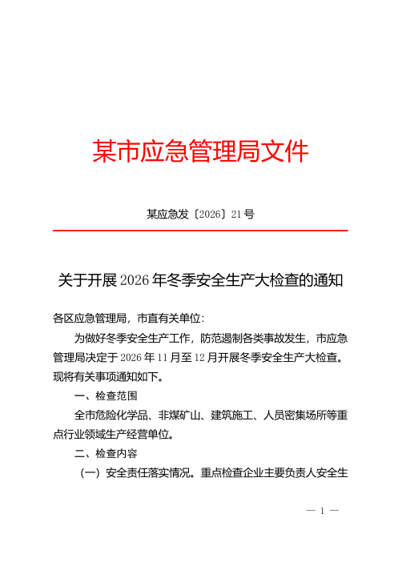

<!-- README_SYNC: source=working-tree; updated=2026-10-22 -->

<div align="center">

# gongwen-skills · Official Document Writing Skills

**Skills for writing Chinese official documents — no fabrication, confidentiality-aware, one-command GB/T 9704 formatting.**

[简体中文](README.md) · English

If this project solves a real problem for you, a Star helps others with the same need find it.

[](https://github.com/duyunzhoudyz/gongwen-skills/stargazers)
[](LICENSE)

[](CHANGELOG.md)
[](#quick-start)

[Quick Start](#quick-start) · [Skill Map](#skill-map) · [Just Say It](#just-say-it) · [Results](#results) · [FAQ](#faq) · [Community](#community)

</div>

> **Confidentiality notice**: Never input classified information into any internet-connected AI tool. For internal documents, use your organization's on-premises model. The prompt-only edition and offline bundle of this project work on air-gapped deployments. See [使用须知](使用须知.md) for details.

<div align="center">



*Page 1 of a letterhead notice sample built by `gongwen-format` per GB/T 9704-2012 (test sample rendered with LibreOffice, fictional content; actual fonts depend on what is installed locally)*

</div>

---

## What makes this different from plain AI writing

| | Plain AI writing | gongwen-skills |
|---|---|---|
| Facts and figures | Fabricates when missing | Uses only your materials; gaps marked `[TO FILL]` |
| Length | Pads to fill space | Writes to your specified length; no invented content |
| Tone | AI jargon, bureaucratic filler | Removes AI tone; preserves legitimate official style |
| Stance | Hedged, disclaimer-heavy | Clear wording; uncertain items moved outside the body |
| Formatting | Manual | One-command GB/T 9704-compliant Word output; script-checked punctuation, numbers, and file codes |
| Org variation | One-size-fits-all | 7 organization profiles, 5 role modes, 5 sector packs |

**Evaluation summary**: run head-to-head against 8 similar official-document skills on GitHub — same model, same tasks — and scored double-blind by two LLM judges, Claude and DeepSeek (not human reviewers), on two held-out task sets.

- **Fabrication and fact preservation**: all 682 facts preserved in the de-AI-tone pass, 0 fabrications flagged by either judge; fewest fabrication runs in the writing track (11/40)
- **Confidentiality, layout, fonts**: stops on a classification mark on the first page (only 2 such tasks, so a small sample); GB/T 9704 layout audit 96.6; names the standard fonts when they are missing and tells the user, never substituting
- **Overall writing quality**: top cluster, not yet consistently first. Average rank: 2nd by the Claude judge, 6th by the DeepSeek judge, 0.1–0.6 rank behind the strongest competitor

Per-dimension numbers, who we were compared against, limitations, and reproducible scripts: see [Results](#results) below and the [compete report](evals/results/compete-report.md).

---

## Quick Start

Choose your tooling:

| You use | How to install |
|---|---|
| DeepSeek, Doubao, Kimi (web), or org on-premises model | No install needed — copy the prompt, see [Option 4](#option-4-web-llm-or-on-premises-no-install) |
| Claude Code | Two commands in the plugin marketplace, see [Option 2](#option-2-claude-code-plugin-marketplace) |
| Codex, Cursor, Gemini CLI, GitHub Copilot, Qwen Code, Kimi Code CLI | One-line script, see [Option 1](#option-1-one-line-install-script) |
| Already running an Agent | See [Option 5](#option-5-let-your-agent-install-it) |

The skills-directory paths for Trae and CodeBuddy are not fully verified. The install script ships targets for them (`--target trae`, `--target codebuddy`); feel free to try them and open an Issue if something is off.

### Option 1: One-line install script

1. Download the repo. With git, run `git clone https://github.com/duyunzhoudyz/gongwen-skills.git`; without it, click the green **Code** button at the top of the page, choose **Download ZIP**, and unzip it.
2. Run the script from the repo folder (on Windows, type `powershell` in the folder address bar; on macOS/Linux, open a terminal in that folder):

```powershell
powershell -ExecutionPolicy Bypass -File .\install.ps1
```

```bash
bash install.sh
```

The script checks for Python 3.9+, asks whether to install formatting dependencies, then installs the 17 core skills into every supported Agent tool it finds. To preview without writing any files, add `-WhatIf` (Windows) or `--dry-run` (macOS/Linux).

See which tools are supported, or install to a specific tool only (Qwen Code as the example):

```bash
python tools/install.py --list-targets
python tools/install.py --target qwen
```

### Option 2: Claude Code plugin marketplace

```text
/plugin marketplace add duyunzhoudyz/gongwen-skills
/plugin install gongwen@gongwen-skills
```

### Option 3: npx skills (requires Node.js)

```bash
npx skills add duyunzhoudyz/gongwen-skills
```

### Option 4: Web LLM or on-premises (no install)

Open [`dist/prompts/`](dist/prompts/), copy the full content of a prompt file, paste it at the start of your conversation, then describe what you need. Start with `gongwen.md` (the router skill).

- Each skill has one prompt file (~26,000–29,000 characters).
- When switching to the next skill, the current session gives you a handoff card. Open a new conversation, paste the next prompt, then paste the handoff card and your materials.
- For air-gapped use, build the offline bundle with `python tools/build_prompts.py --offline` (output goes to `dist/offline/`).

### Option 5: Let your Agent install it

Send this to your Agent:

```text
Please install the skills from the skills/ directory of
https://github.com/duyunzhoudyz/gongwen-skills into your skills directory.
The following are sector packs — install only gongwen-hospital for now:
gongwen-grassroots, gongwen-hospital, gongwen-university, gongwen-k12, gongwen-soe.
Tell me which skills are available once done.
```

### Adding sector packs

Sector packs extend the core skills for industry-specific documents. Example for hospitals:

```text
/plugin install gongwen-hospital@gongwen-skills
```

```bash
bash install.sh --pack hospital
```

The install script accepts several packs: `--pack hospital --pack soe`; install all with `--pack all`.

For the web edition, use the matching file in `dist/prompts/`, e.g. `gongwen-hospital.md`.

> **Dependencies**: Word formatting and Excel charts require Python 3.9+ and `python-docx`, `openpyxl` (`pip install python-docx openpyxl`; the install script will ask). Without Python, the format skill outputs a manual setup checklist for WPS/Word.
>
> **Uninstall**: Add `--uninstall` to the install command, review the file list, then add `--yes`.

---

## Skill Map

17 core skills ship in one plugin; 5 sector packs install separately.

Maturity: **Stable** = real-model eval pass rate >= 80%, zero fabrications, correct triggering. **Beta** = sample-tested; will be upgraded after field feedback.

**Router & configuration**

| Skill | What it does | Maturity |
|---|---|---|
| [`gongwen`](skills/gongwen/) Router | Takes vague requests, identifies document type and direction, builds a quick org profile with 3 questions, routes to the right skill | Stable |
| [`gongwen-profile`](skills/gongwen-profile/) Org profile | Full org file; learns writing style from past documents; extracts leader editing preferences; manages banned-word list | Stable |

**Drafting**

| Skill | What it does | Maturity |
|---|---|---|
| [`gongwen-draft`](skills/gongwen-draft/) Statutory documents | Notices, requests, reports, inter-agency letters, circulars, approvals, opinions, sign-offs, decisions, announcements; verifies document type before drafting | Stable |
| [`gongwen-report`](skills/gongwen-report/) General documents | Work summaries, plans, key tasks, briefings, research reports, experience write-ups, accountability statements, implementation plans, conference reports | Stable |
| [`gongwen-speech`](skills/gongwen-speech/) Speeches | Leadership speeches, host scripts, toasts, position statements, exchange speeches, delegate speeches; word count set by speaking time | Stable |
| [`gongwen-party`](skills/gongwen-party/) Party affairs | Self-examination materials, Party-work reports, Party lectures, discussion speeches, study reflections, branch meeting minutes; outline-only when personal examples are absent | Stable |
| [`gongwen-brief`](skills/gongwen-brief/) Briefs & news | Government information briefs, newsletters, press releases, WeChat articles; condenses long materials; assesses whether a brief is likely to be adopted | Stable |
| [`gongwen-minutes`](skills/gongwen-minutes/) Meeting minutes | Meeting records, minutes, agenda materials, action items; records only, no additions; distinguishes approved / approved-in-principle / deferred | Stable |
| [`gongwen-implement`](skills/gongwen-implement/) Policy implementation | Extracts key points from superior documents, task breakdowns, implementation plans, follow-up reports; detects verbatim copying and flags over-mandating | Stable |
| [`gongwen-rectify`](skills/gongwen-rectify/) Rectification | Rectification plans, issue trackers (Excel export), progress reports, self-inspection reports; cross-checks report status against tracker | Stable |

**Editing & QA**

| Skill | What it does | Maturity |
|---|---|---|
| [`gongwen-title`](skills/gongwen-title/) Titles & outlines | Document titles, subtitle options, three heading-style variants, outlines; checks title-body alignment | Stable |
| [`gongwen-polish`](skills/gongwen-polish/) Polishing | Compression, fact-only expansion, register conversion, plain-speech-to-official, revision by leader notes, multi-draft merge | Stable |
| [`gongwen-humanize`](skills/gongwen-humanize/) De-AI-tone | Removes AI-style filler; preserves legitimate official document conventions; facts untouched | Stable |
| [`gongwen-direct`](skills/gongwen-direct/) De-hedging | Removes disclaimers; converts "it is suggested" to directives; ensures requests include a position | Stable |
| [`gongwen-review`](skills/gongwen-review/) Proofreading | Eight-gate review, tiered issue list; script-checks punctuation, numbers, formatting, confidentiality, banned words | Stable |

**Delivery tools**

| Skill | What it does | Maturity |
|---|---|---|
| [`gongwen-format`](skills/gongwen-format/) GB/T 9704 formatting | Generates six Word layout types per GB/T 9704-2012 (letterhead, correspondence, minutes, plain, material, newsletter); repairs existing docx files | Stable |
| [`gongwen-data`](skills/gongwen-data/) Data & charts | Table audits, YoY/MoM calculations with formulas, turns data into document-ready sentences, generates black-and-white Excel charts locally | Stable |

**Sector packs** (install separately)

| Skill | What it does | Maturity |
|---|---|---|
| [`gongwen-grassroots`](skills/gongwen-grassroots/) Township/community | Inspection briefings, resident notices, emergency notices, work logs, village/community affairs disclosure | Beta |
| [`gongwen-hospital`](skills/gongwen-hospital/) Public hospital | Accreditation self-assessment, performance analysis, RCA/PDCA, department chief report (DRG/CMI), party committee and director office agenda | Beta |
| [`gongwen-university`](skills/gongwen-university/) University | Audit self-assessment, discipline evaluation, grant application review, college summary, sign-off routing decisions | Beta |
| [`gongwen-k12`](skills/gongwen-k12/) K-12 school | Semester plans and summaries, inspection self-assessment, parent-meeting speech, student comments, parent letters | Beta |
| [`gongwen-soe`](skills/gongwen-soe/) State-owned enterprise | "Three major decisions" agenda, board resolutions, GM-office minutes, ESG report, compliance management report | Beta |

---

## Just Say It

Send your task directly — no need to name a skill:

| What you send | Handled by |
|---|---|
| "Help me figure out what document type this should be, then draft it. (background materials attached)" | `gongwen` router |
| "Here is the transcript of this morning's safety meeting. Produce the minutes and a task list of decisions made." | `gongwen-minutes` |
| "Write a department year-end summary, around 2,000 characters. Source materials in the attachment. Do not invent any data." | `gongwen-report` |
| "This is an AI-generated draft. Remove the AI jargon — buzzwords like 'empower', 'closed loop', 'full chain' — and rewrite in normal official-document tone. Do not change any figures or examples. (draft attached)" | `gongwen-humanize` |
| "Change every 'it is suggested that each unit' and 'may consider' in this notice to a firm requirement. (notice attached)" | `gongwen-direct` |
| "This request memo goes for signature tomorrow. Proofread it for any issues, then format it as a standard letterhead Word file. (memo attached)" | `gongwen-review` then `gongwen-format` |
| "The city issued this document. Extract the task list and write our unit's implementation plan. (document attached)" | `gongwen-implement` |
| "The inspection team flagged 9 issues. Build a rectification plan and a tracker; the tracker needs to export to Excel. (issue list attached)" | `gongwen-rectify` |
| "Grade evaluation is next week. Write the department self-assessment report with a focus on DRG and CMI metrics. Data attached." | `gongwen-hospital` sector pack |
| "For the teaching audit, write the college section on 'teaching resources and utilization'. Requirements in the attachment." | `gongwen-university` sector pack |
| "The capital injection to the subsidiary goes to the party committee next week as a three-major-decision item. Prepare the agenda materials — issue brief and draft resolution both needed." | `gongwen-soe` sector pack |
| "The community has a water shutdown Tuesday for maintenance. Write a notice for the building entrance and a short message for the residents group chat." | `gongwen-grassroots` sector pack |

---

## Workflow

| Scenario | Route |
|---|---|
| Year-end summary, accountability report, briefing | `gongwen` confirm -> `report` build material log and draft -> `direct` + `humanize` clean up tone -> `review` proofread -> `format` Word output |
| De-AI-tone pass on an existing draft | `direct` -> `humanize` -> `review`, add `format` for Word |
| Implementing a superior policy document | `implement` extract key points + task table + plan -> `direct` -> `review` -> `format` |

In tools that support multiple skills, the router hands off between stations. In the web edition, each station ends with a handoff card -- paste it into the next prompt to continue.

---

## Results

### Before and after: de-AI-tone on a real notice

A mock district-level education bureau notice about winter campus safety checks, processed through `gongwen-direct` -> `gongwen-humanize` -> `gongwen-review` (full example at [examples/B-AI稿体检](examples/B-AI稿体检/)):

| Check | P0 (must fix) | P1 (suggested) | Length |
|---|---:|---:|---:|
| Original | 5 | 31 | 1,092 chars |
| After | 0 | 0 | 814 chars |

Other changes: "it is suggested that each school establish a task force" changed to "each school shall establish a task force"; file code format corrected; a clause threatening parents with detention removed after confirming the district education bureau has no such authority.

Two more examples: [hospital department year-end summary](examples/A-医院科室年终总结/) and [when to use an inter-agency letter vs. a formal request](examples/C-文种判断-函/).

### Head-to-head test against 8 similar projects

This project was run against 8 similar official-document skills on GitHub: same model (claude-sonnet-5-5), same prompts and materials. Conclusions come from two **held-out** task sets (c4, c5; 54 tasks, 552 runs, all materials fictional). Rounds c2 and c3 were tuned on the same tasks and are not used as evidence.

| Dimension | This project | Best result among the others |
|---|---|---|
| De-AI-tone: fact preservation (682 items) | **100%, 0 fabrications** | 98.4%, 15 fabrications; another project also scored 100% but changed only 0.6% of the text and delivered no body text in 11 runs |
| Formatting: GB/T 9704 audit score | **96.6** | 93.2 |
| Formatting: font honesty | **Always names the standard fonts (32/32)** | Always substituted fonts (32/32); 12 runs without telling the user |
| Writing: runs with fabrications (Claude judge) | **11/40** (fewest) | 16/40 and 17/40 |
| Classified content recognition | 2/2 on the c4 tasks (only project to detect); in c5 the mark was only in the page header and every entrant, this project included, missed it | 0/2 on c4 |
| Writing quality (avg rank) | 2nd by the Claude judge (3.20); 6th by the DeepSeek judge (3.88) | 1st: 3.15 (Claude judge); a different project leads the DeepSeek judge |
| Formatting quality (avg rank) | 3rd (2.72) | 1st: 2.12 |
| De-AI-tone quality (avg rank) | 3rd by the Claude judge (2.19); 2nd by the DeepSeek judge (1.97) | 1st: 1.78 / 1.69 |

On the dimensions where errors are unacceptable — fabrication prevention, fact preservation, formatting compliance, font honesty — this project has the best results among the entrants. Overall quality is in the top cluster, 0.1–0.6 rank behind the strongest competitor and not yet consistently first.

Caveats:

- The judges are two LLMs, not humans, and the Claude judge is the same model that was tested (claude-sonnet-5-5). Human blind review is on the [Roadmap](#roadmap).
- Only 2 classified-content tasks were used, so the sample is tiny. This project also missed the header-only mark in c5; it was fixed after the results were seen, and only this project was re-run to confirm.
- Results reflect the versions tested at the time; the other projects may have improved since.

Full methodology, per-skill breakdown, limitations, and reproducible scripts: [compete report](evals/results/compete-report.md).

### v1.0 full evaluation

Test model: claude-sonnet-5-5. 372 test cases, 2,671 check items, all materials fictional, blind scoring.

| Criterion | With skills | Without skills |
|---|---:|---:|
| All check items pass rate (2,671) | **98.6%** | 54.1% |
| Universal check items pass rate (1,726) | **99.1%** | 68.7% |
| Runs with fabrications (136 anti-fabrication cases) | **0** | 66 |
| Cases correctly stopped for classified content (21) | **21** | 3 |

> In the second round the with-skills group was re-run at max reasoning effort while the without-skills group reused the first round's outputs, so this is not a like-for-like comparison. The like-for-like first round is 97.1% vs 54.0% (universal items 97.7% vs 68.5%). Each case ran once, and the grader is the same model as the one under test.

All 17 core skills: pass rate >= 97.4%, zero fabrications, correct triggering -- rated Stable. The 5 sector packs meet the numeric thresholds; staying Beta until field feedback and human blind-test. Full methodology and limitations: [v1.0 evaluation report](evals/results/v1.0-benchmark.md).

---

## Six non-negotiable rules

All skills follow these rules ahead of any workflow logic (full text: [shared/guardrails.md](shared/guardrails.md)):

1. **Confidentiality before generation**: Stop and alert when a classification mark, "internal document", or personal sensitive information is detected.
2. **Facts only from user materials**: Figures, examples, file codes, and policy citations come from your materials only. Missing items are marked [TO FILL]; uncertain items go to the drafting note, not the body.
3. **Clean body, notes outside**: No disclaimers or AI self-descriptions in the document body. Items requiring verification go to the drafting note section.
4. **Default to shorter**: Get to the point; follow length-reduction regulations; do not copy verbatim from superior documents. If you specify a length, that is the target. No padding.
5. **Rules are traceable and script-checked**: Every formatting, punctuation, and number rule cites its clause number. Anything checkable by script is not left to the model.
6. **Assist, do not ghostwrite**: For self-examination and accountability materials requiring personal experience, provide an outline only when no source material is supplied.

Regulatory basis: Party-Government Document Handling Regulations, GB/T 9704-2012, GB/T 15834-2011, GB/T 15835-2011, Regulations on Reducing Formalism for Grassroots. Rules with clause numbers: [shared/rules/](shared/rules/). The check engine covers 12 rule categories across 41 document types.

---

## FAQ

**Who is this for?**

Anyone using AI to write Chinese official documents:

- **Government and public-institution writers**: notices, requests, reports, letters, minutes — high volume, tight deadlines, strict formatting
- **Mid-level managers who draft their own materials**: leadership speeches, accountability reports, key tasks
- **Public hospital admin and clinical staff**: accreditation self-assessment, performance analysis, RCA/PDCA, department chief reports — these involve DRG, CMI, and infection-control metrics that are easy to get wrong; the hospital sector pack follows public-hospital publishing systems and indicator standards
- **University colleges and functional offices**: audit self-assessment, discipline evaluation, grant application review, internal sign-offs and "school-issued vs. department-issued" routing — universities have a two-tier publishing logic and evaluation requirements, and the sector pack checks the issuing level and flags omissions against them
- **SOE general and legal departments**: "three major decisions" agenda, board resolutions, GM-office minutes, ESG reports, compliance reports — pre-decision procedures and compliance boundaries are hard requirements; the sector pack checks for prior review and keeps resolutions and minutes distinct
- **K-12 teachers and academic affairs**: semester plans, inspection self-assessment, parent-meeting speech, student comments, parent letters
- **Township and community staff**: inspection briefings, resident notices, emergency notices, work logs — resident-facing notices must be plain and accurate; inspection materials must line up with the checklist
- **Anyone worn down by AI-generated drafts**: fabrication, AI tone, formatting errors, hedged language — every item requires manual correction

**Do I need Claude?**

No. The skill edition supports Claude Code, Codex, Cursor, Gemini CLI, GitHub Copilot, Qwen Code, Kimi Code CLI, and others. Without those tools, use the prompt edition: copy from `dist/prompts/` and paste into DeepSeek, Doubao, Kimi, or your org on-premises model.

**Can I paste in real work documents?**

Classified documents and anything marked internal or work secret must not go into any internet-connected AI tool. Use your org on-premises model for those. The prompt edition and offline bundle work on air-gapped deployments. The skills will stop and alert when they detect a classification mark, but the responsibility for that judgment rests with the user.

**Will it fabricate data?**

Rules require using only the materials you provide. Missing items are marked [TO FILL]; uncertain items go to the drafting note. In the v1.0 evaluation, 136 test cases deliberately withheld materials -- zero fabrications with skills installed. Model output is non-deterministic; verify numbers, names, and file codes before finalizing.

**Font or Python issues?**

The project does not bundle fonts and will not substitute alternatives. When standard fonts are missing, the format skill names the missing ones and tells you where to obtain them. Without Python, it produces a manual WPS/Word setup checklist.

---

## Roadmap

- [x] v0.1: Router, general documents, titles, de-AI-tone, de-hedging, proofreading, formatting
- [x] v0.2: Org profile, statutory documents, speeches, party-affairs materials, polishing
- [x] v0.3: Policy implementation, rectification, meeting minutes, briefs, data & charts
- [x] v0.4: Sector packs -- township, hospital, university, K-12, SOE
- [x] **v1.0.0** (current version): All 22 skills in one release; real-model evaluation; one-line install script and sector-pack selection

**Planned**

- [ ] Cross-model evaluation: prompt edition on DeepSeek, Qwen, Kimi
- [ ] Field feedback and human blind-test; upgrade sector packs from Beta when benchmarks pass
- [ ] Real-device test of Word/WPS formatting and font detection on macOS/Linux
- [ ] Word tracked-changes output (currently writes comments only)

To help with testing, see [测试者手册](docs/评测/测试者手册.md). Uses fictional materials; no programming required.

---

## Community

<div align="center">


**Scan to join the gongwen-skills discussion group (WeChat Work)**

Commercial licensing and partnership inquiries welcome through the same channel.

</div>

Bug reports, rule corrections, and new scenarios: open an [Issue](https://github.com/duyunzhoudyz/gongwen-skills/issues/new/choose). Usage tips and experience are welcome as Issues too, or scan the QR code above to join the group. Contributing: [CONTRIBUTING.md](CONTRIBUTING.md).

If this project has helped you, a Star or a coffee keeps it going.

<div align="center">


</div>

---

## Acknowledgments

This project drew on ideas and content from several open-source projects. Licenses and attribution details: [THIRD_PARTY_NOTICES.md](THIRD_PARTY_NOTICES.md), with per-item records at [docs/借鉴记录/](docs/借鉴记录/).

---

## License

Source-available. Free for personal, educational, research, and other non-commercial use under the license terms. Commercial use -- including commercial integration, paid services, SaaS, internal business processes, or commercial redistribution -- requires prior authorization.

[PolyForm Noncommercial 1.0.0](LICENSE). The rule summaries in this project are derived from public regulations and national standards and do not replace the originals.
