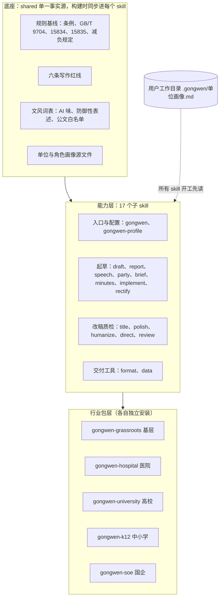

# 公文写作 Skills 集合 · 顶层设计

> 版本：v1.0 定稿　日期：2026-10-16 起草，2026-10-20 勘误定稿　状态：已批复，v1.0.0 计划 2026-10-31 发布
>
> 定稿说明：本文是 2026-10-16 起草并获批复的设计。v1.0 定稿时对照实际实现做了勘误：目录、文件名、数字等与实现不符之处直接改正，并在原处注明原写法；发布节奏（第 0、4.0、7.1、9 节）因《下一轮工作计划》决策 D6 调整，保留原计划并加勘误注记。
>
> 本文基于 4 路并行调研：一线场景与痛点、规范与政策、可借鉴的开源项目、Skill 集合的产品形态。文中 GitHub star 数和许可证已于 2026-10-16 通过 GitHub API 抽查核验。标注【未核实】的内容来源存疑，引用前需要复核。

---

## 0. 一页纸摘要

**一句话定位**：给机关、事业单位、国企文字工作者用的开源公文写作 Skills 集合。它懂规矩（《条例》与国标），懂单位，懂角色；它不编造事实，守保密，帮人做减法。

**为什么还值得做**：GitHub 上已有十余个公文 skill（最高约 1.5k star），但几乎都在做两件事：文种模板和 GB/T 9704 排版。调研发现以下 7 块仍是空白：

1. 行文规则与文种决策：请示、报告、函怎么选，是否越级，是否多头主送。
2. 事实台账与防编造：AI 编造案例和数据已出现被通报、被纪委立案的真实事件。
3. 单位与角色差异：医院、高校、国企的发文体系、决策程序、红线差别很大，现有项目基本只面向党政机关。
4. 减负合规：2024 年《整治形式主义为基层减负若干规定》对篇幅有硬性上限，要求开门见山、不照抄上位文件。
5. 保密前置与脱敏。
6. 标点和数字用法的确定性机检：按 GB/T 15834 和 GB/T 15835 做检查的开源规则库，目前基本没有。
7. 公开的评测数据：现有项目都没有展示"装 skill"和"不装 skill"的效果对比。

**体系**：分三层。

- 底座：共享规则与写作红线。
- 中间：17 个功能子 skill，分为入口配置、起草、改稿质检、交付工具四组。
- 上层：5 个行业包，分别面向基层、医院、高校、中小学、国企。

单位和角色的差异，通过一份"单位画像"文件注入所有 skill。

**运行形态**：同一套源文件产出三种形态。

- Skill 版：Claude Code、Codex、Cursor、Trae、Kimi Code CLI、Qwen Code 等。
- 提示词版：DeepSeek、豆包、Kimi 等网页端。
- 内网离线版：政务内网部署的国产模型。

之所以这样设计，是因为体制内的真实材料大多不能上传境外模型，项目必须做到模型无关。

**节奏**（2026-10-16 确认）：v0.1「年终季版」在 10 月底前发布，包含 7 个 skill，赶在 11–12 月年终总结和述职高峰之前。之后按写作日历滚动发布：

- 11 月下旬：v0.2「开年版」，包括讲话、党建、法定公文、改稿、单位画像，覆盖年终高峰后段和民主生活会。
- 2027 年 1–2 月：v0.3「落实版」。
- 2027 年 3–5 月：行业包。

> **勘误**（2026-10-20，依据《下一轮工作计划》决策 D6）：上述分批发布的节奏已调整。v0.2～v0.4 的 15 个 skill 提前完成开发，与 v0.1 的 7 个 skill 合并，于 2026-10-31 一次发布 v1.0.0，共 22 个 skill（核心 17 个、行业包 5 个），用 Stable、Beta 成熟度标签区分，行业包统一标 Beta；运营上仍按写作日历分月主推不同 skill。第 4.0 节版本列、第 7.1 节时间线，以及第 8、9 节中按 v0.1～v0.4 分批交付的说法，保留原计划作演进记录，以本勘误为准。

第 9 节的 7 项决策已于 2026-10-16 确认。

**当前进展（2026-10-20）**：22 个 skill 已全部完成开发，其中核心插件 `gongwen` 含 17 个，5 个行业包各为独立插件，共 6 个插件。已完成交叉审查、完整性审查，以及第一轮真实模型评测和据此的修复；机检引擎覆盖 12 类检查、41 类文书；提示词版 22 份，一键安装脚本、离线包的构建脚本和离线使用说明、release 工作流已就绪（离线包随 v1.0.0 发布时上传），3 个端到端示例见 `examples/`。单元测试在最近一次完整运行中全部通过，项数以发布前最后一次实跑为准。修复后的 A 组复测已完成（结论见 `evals/results/v1.0-benchmark.md`），17 个核心 skill 按 D7 评为 Stable，5 个行业包为 Beta；定于 2026-10-31 发布 v1.0.0。跨模型评测、人工盲评和测试者反馈留给测试者，评测说明与记录表见 `docs/评测/`。

---

## 1. 调研结论

### 1.1 一份材料的生命周期，以及 AI 能介入的环节

| 环节 | 一线难点 | AI 介入方式 | 对应 skill |
|---|---|---|---|
| 接任务 | 领导口头交办，意图模糊；上级来文时限紧，要求"对标对表"；迎检要准备成套佐证 | 解析上级来文，拆出任务清单和时间节点 | gongwen-implement、gongwen |
| 领会意图、定调子 | 新人把"代人言事"写成"写自己想说的"；年终总结定调公认最难 | 从领导讲话、批示里归纳要点，生成任务卡 | gongwen、gongwen-profile |
| 收集素材 | 约占整个周期的 30–50%（经验估计）；下级报送质量参差、口径打架，容易写成"剪辑堆砌" | 清洗素材，标记口径冲突，建立素材台账 | gongwen-report、gongwen-data |
| 起草 | 标题和小标题难起，结构和篇幅难分配 | 出提纲和标题备选，分段成稿 | 起草类 skill、gongwen-title |
| 修改 | 改六七稿很常见，最后改回原稿；领导意见多为口头 | 解读领导改过的"花脸稿"，沉淀成领导偏好卡 | gongwen-polish、gongwen-profile |
| 核稿 | 逐项核行文理由、依据、文种、格式；签发后有实质修改须重新签发 | 检查提法、文种、格式、数字前后一致 | gongwen-review |
| 排版 | Word 默认参数不符合 GB/T 9704；AI 输出常带 Markdown 符号 | 直接产出国标 docx，或修复已有稿件 | gongwen-format |
| 报送、归档 | 有时限要求；政务信息按采用情况积分排名 | 报送清单、归档目录 | gongwen-brief |

**结论**：难点集中在动笔之前和之后。动笔前是领会意图、找素材、统一口径；动笔后是反复改稿和核稿。起草本身反而不是瓶颈。AI 最适合做两头："素材 → 提纲 → 初稿"和"核稿 → 排版"。事实内容只能来自用户。

### 1.2 写什么：频次分层与写作日历

**按频次分层**（依据招聘 JD、培训课程目录和一线文章归纳）：

| 频次 | 文书 |
|---|---|
| 几乎每周 | 信息简报、新闻稿、汇报材料、通知、会议纪要 |
| 每月或每季 | 讲话稿、实施方案、请示、报告、函、经营分析（国企） |
| 每年必写 | 工作要点、年度总结与计划、述职述责述廉、民主生活会对照检查材料、党建工作报告 |
| 事件触发 | 巡视巡察、审计、督查的整改方案和整改报告；调研报告；经验材料；迎检自评报告；突发事件信息 |

《条例》规定的 15 个法定文种里，日常高频的只有通知、请示、报告、函、纪要几种。**一线最常写的是非法定文种的"材料"**，这一点决定了 skill 的划分重心。

**写作日历**（也是发版和内容运营的节奏）：

| 时间 | 写作高峰 | 对应 skill |
|---|---|---|
| 1–2 月 | 年度工作会讲话、工作要点、地方两会；民主生活会和述职（年底至年初） | speech、party、report |
| 3 月 | 全国两会后的学习贯彻材料 | implement |
| 4–6 月 | 一季度分析；上市国企 ESG 报告；安全生产月；"七一"党建材料和党课讲稿 | data、soe 包、party |
| 7 月 | 半年总结、上半年运行分析（全年第二高峰） | report、data |
| 9 月 | 开学季讲话、学期计划 | university 包、k12 包 |
| 11–12 月 | 年终总结、次年计划、述职、考核迎检（全年最高峰） | report、review、format |
| 全年 | 信息、通知、纪要；由巡视巡察、审计、督查触发的整改 | brief、draft、minutes、rectify |

行业节点：

- 医院：国考数据填报窗口每年不同；年初有科室主任述职。
- 高校：审核评估、开学和毕业季。
- 中小学：学期初写计划，学期末写总结。
- 国企：年初开年度工作会和职代会，每月做经营分析。

### 1.3 十二个真实痛点

| # | 痛点 | 一线表现 | 出处 | 对应设计 |
|---|---|---|---|---|
| 1 | 意图难把握 | 新人没吃透意图，被要求整篇重写 | 共产党员网 2021-10 | 入口任务卡、教学模式 |
| 2 | 材料荒 | 只向下要材料，写成"剪辑堆砌" | 共产党员网 2023-12 | 素材台账 |
| 3 | 反复改稿 | 改六七稿，最后又改回原稿 | 豆瓣书评 | 改稿说明、花脸稿学习 |
| 4 | 领导风格难把握 | 笔杆子靠研究"花脸稿"摸规律 | 共产党员网 2022-09【篇目未核实】 | 领导偏好卡 |
| 5 | 起标题难 | 小标题"大而无当"或与正文脱节 | 共产党员网 2022-07 | gongwen-title |
| 6 | 提法不准 | 与党章表述不一致；沿用已停用的概念（如"老少边穷"） | 共产党员网 2021-04 | 提法风险标记 |
| 7 | 格式与文种出错 | Word 默认参数与国标不符；请示、报告混用 | 北航公文处理办法 | 文种决策树、国标排版 |
| 8 | 数据汇总繁琐 | 医院指标靠手工统计，难以溯源；企业各部门口径打架 | 行业期刊、厂商博客 | gongwen-data |
| 9 | 套话、流水账、复制粘贴 | 人民日报来论批评"改个名称换个数字"式总结 | 人民日报来论 2025-12 | 去 AI 味、压缩篇幅 |
| 10 | 时间紧、任务多头 | 有基层干部一个月领到十几二十项调研任务 | 新京报 | 整体提效 |
| 11 | 留痕负担 | 护士长"每天都在写"；班主任每周非教学工作平均 12.3 小时 | 健康界；北师大调研（澎湃） | 行业包 |
| 12 | AI 稿翻车 | 编造案例和数据、违法表述、泄密（见 1.6） | 川观新闻 2026-09 等 | 六条红线、核稿 |

### 1.4 不同单位的差异

| 单位 | 典型文书 | 特有程序和术语 | 红线 | 最大痛点 |
|---|---|---|---|---|
| 省市级机关 | 意见、通知、领导讲话、调研报告、综合汇报、信息专报 | 会签、征求意见；发文审核"八关"（政治、政策、权限、法规、文风、文字、格式、程序） | 提法与党章或中央表述不一致；使用停用概念 | 口径要准、站位要高、讲话要有个人风格 |
| 县乡基层 | 落实方案、汇报、迎检台账、政务信息、整改报告 | 政务信息积分排名；痕迹管理 | 虚报数据；未整改却标"已完成" | 多头要材料、表格重复，被称为"笔尖上的形式主义" |
| 街道社区 | 台账、总结、居民通知、迎检材料 | 社区工作准入清单；"一表通" | 面向群众的通知里法律表述出错 | 报表多、台账多、迎检负担重 |
| 公立医院 | 院长讲话、党委会和院长办公会议题与纪要、等级评审和国考自评、医疗质量报告、不良事件分析、科室述职 | 党委领导下的院长负责制；"三重一大"须集体决策；DRG、CMI、星号指标 | 患者隐私；数据不可溯源；议题跳过前置程序 | 指标多，数据靠手工；党建和业务"两张皮" |
| 高校 | 党代会和教代会报告、书记校长讲话、审核评估自评报告、项目申报、辅导员谈心记录 | 校级和部门两级公文；学院数据须与学校自评一致；"十清楚、六必谈" | 意识形态表述；学生隐私；须本人手写的记录 | 政治性要求高、多轮征求意见；节点多、材料细 |
| 中小学 | 学校发展规划、督导自评、教学计划总结、班级计划总结、家长会讲话、学生评语 | 党组织领导的校长负责制；进校园活动白名单 | 学生隐私；给教师摊派超职责任务 | 多头检查、数据填报多 |
| 国企 | 年度工作会报告、董事长和总经理讲话、总经理办公会议题与纪要、董事会议案、经营分析、改革台账、ESG 报告 | 党委前置研究后再提交董事会或经理层决策；"授权不授责"；签报；党政两套代字 | 决策程序倒置；信息披露违规；商业秘密 | 业务专业性强，各部门数据打架 |

### 1.5 不同角色的差异

| 角色 | 典型任务 | 能力特征 | 核心需求 | 用 AI 的特点 |
|---|---|---|---|---|
| 新入职公务员、选调生 | 信息、纪要、通知、初稿 | 文字底子不差，不熟悉语境 | 判断文种、找范式、弄懂"为什么这样改" | 最依赖 AI，也最容易照单全收 |
| 专职笔杆子 | 讲话稿、综合汇报、年度报告 | 能力强，长期超负荷 | 整理素材、沉淀领导风格、提速 | 只用 AI 出提纲和润色，最在意 AI 味和提法 |
| 业务科室兼职写作者 | 本条线的总结、方案、数据分析、整改台账 | 懂业务，不懂公文 | 把业务语言转成公文语言，搞定格式 | 需求在上升（有单位取消专职笔杆子，改为"事随人走"） |
| 党务、宣传岗 | 党建报告、党课、对照检查材料、新闻稿 | 对提法高度敏感 | 提法准确，避免雷同 | 提法过时和雷同的风险最高 |
| 中层领导 | 审稿、改稿、把关 | 判断力强，时间少 | 快速过一遍政治、政策、数字、逻辑 | 需要的是审稿助手，不是写稿助手 |
| 主要领导 | 讲话、听汇报、批示 | 关注观点和决策 | 一页纸摘要；讲话口语化、有记忆点 | 自己基本不用，但对空话最敏感 |

### 1.6 AI 写公文的现状与翻车类型

**部署现状**

- 2025 年 2 月起，各地政务外网或本地环境大量接入 DeepSeek，公文起草和纠错是主要场景。例如安徽"皖政通"、合肥政务 OA、南京和赣州的写作助手。
- 2025-10-10，中央网信办和国家发展改革委发布《政务领域人工智能大模型部署应用指引》，要点有四条：
  - 防止国家秘密、工作秘密和敏感信息输入非涉密大模型；
  - 落实大模型的"辅助型"定位，防范"幻觉"；
  - 防范"数字形式主义"；
  - 县级及以下原则上复用上级的算力和模型。

**翻车类型与对策**

| 类型 | 真实案例 | skill 对策 |
|---|---|---|
| 编造事实 | 某县干部让 AI 为 4 个问题各配一个本地案例，2 个张冠李戴，2 个查无此企业（川观新闻、法治日报，2026-09）；民盟河南省委会通报部分社情民意稿件的案例和数据由 AI 编造（21 财经，2026-08） | 事实台账、【待补】标注、正文数字溯源检查、防编造评测 |
| 违法或失当表述 | 村干部用 AI 写通知，内含"直接拘留"等表述，引发舆情后被立案（媒体转述，一手通报【未核实】） | 核稿"法规关"，面向群众的文书专项检查 |
| 泄密 | 国家安全部 2024-08、2025-07 两次通报涉密人员使用 AI 工具导致泄密 | 保密前置、敏感信息扫描、脱敏指引 |
| 提法过时、不懂本地 | 半月谈采访：AI 不懂当地新政策、新提法；写出的公文"框架齐全，其实空无一物" | 提法只标记不替换；政策依据只用用户提供的上级文件 |
| 新八股与 AI 句式 | 通篇"赋能""迭代"；"不是……而是……"、破折号、三段式 | gongwen-humanize |
| 预制材料 | 调研团还没出发，调研报告已经写好（新华网评论，2025-09） | 定位为辅助不代笔；调研报告必须基于调研记录 |
| 雷同露馅 | 文风突然统一或突然变好，被看出来（SCMP） | 文风学习、雷同提醒 |
| Markdown 残留 | 粘贴进 Word 后满屏 `**` 和 `#` | 纯文本输出；核稿机检 |

**一线自发总结的提示词技巧**，正好可以固化成 skill 的默认行为：

| 一线技巧 | skill 中的固化方式 |
|---|---|
| 写明身份、文种、场合、受众、字数 | 入口做 4 维判断，单位画像 |
| 先喂上级文件、领导讲话、本单位数据 | 素材台账 |
| 先出提纲，确认后再分段成文 | 起草类 skill 的标准工作流 |
| 只用给定材料，没有的标"待补充" | 红线第 2 条 |
| 给禁用词清单 | 文风词表 |
| 喂本单位范文学习措辞 | 文风学习 |
| 要求纯文本，不要 Markdown | 输出规范和机检 |
| 人工过格式、逻辑、风格三关 | gongwen-review 的"八关" |

**这个项目的本质，就是把老笔杆子的经验和一线摸索出的提示词技巧，固化成可复用、可检验的工作流。**

### 1.7 规则与政策约束

**规则基线**：截至 2026-10，没有查到以下规则的官方修订版。网传的"2025 年新版条例"在 gov.cn 和新华社都查不到，倾向为误传。

| 规则 | 要点 |
|---|---|
| 《党政机关公文处理工作条例》（中办发〔2012〕14号） | 15 个文种：决议、决定、命令（令）、公报、公告、通告、意见、通知、通报、报告、请示、批复、议案、函、纪要。行文规则：一般不得越级；请示一文一事、原则上主送一个上级机关；报告不得夹带请示事项；下级的请示须提出倾向性意见；除上级负责人直接交办外，不得向领导个人报送公文；不相隶属机关之间请求批准用函。拟制流程为起草、审核、签发 |
| GB/T 9704-2012《党政机关公文格式》 | A4 纸；版心 156×225mm；天头 37mm，订口 28mm；正文 3 号仿宋，每面 22 行、每行 28 字；标题 2 号小标宋；层次序数为 一、（黑体）→（一）（楷体）→ 1.（仿宋）→（1）（仿宋）；发文字号年份用六角括号〔〕；成文日期用阿拉伯数字，不编虚位；页码 4 号半角宋体，两侧加一字线。标准写明"其他机关和单位的公文可以参照执行" |
| GB/T 15834-2011《标点符号用法》 | 标题末尾通常不用标点；带括号的序次语后面不加点号；起止范围用一字线或浪纹线；会议、机构名称不用书名号；省略号不与"等"连用 |
| GB/T 15835-2011《出版物上数字用法》 | 年份不简写；写"9亿～16亿"，不写"9～16亿"；写"15%～30%"；相邻两数字表示概数时中间不加顿号。成文日期按 9704 不编虚位 |
| 《整治形式主义为基层减负若干规定》（2024-08） | 除部署综合性工作外，地方和部门文件一般不超过 5000 字，部署专项工作或者具体任务的文件一般不超过 4000 字（第2条）；开门见山，一般不写形势背景、重要意义；不得照搬照抄上位文件；年度发文一般只减不增；不得"红头"变"白头"规避发文管理；同类材料最多报一次 |

**对产品的影响**：工具应该帮人做减法，例如压缩篇幅、删套话、去掉背景铺垫、标出照抄上位文件的段落。"一键生成万字长文"这个方向与政策相反，新华网已批评 AI 成为形式主义的"帮手"。

### 1.8 竞品格局与空白

**商业产品**

| 产品 | 主打 | 短板 |
|---|---|---|
| WPS AI 政务版 | 15 类法定公文、拟稿校对排版、信创私有化 | 素材深度一般 |
| 讯飞文书、星火 | 以稿写稿、录音转纪要、一键排版 | 早期测评中会直接输出未经核实的数据 |
| 新华妙笔 | 政策库、论述库、长文 | 官方腔重，长文前后重复，年费高 |
| 公文宝等小程序 | 模板加素材库，订阅制 | 有凑字数倾向 |
| 秘塔写作猫 | 校对、润色 | 不负责生成 |

**开源公文 skill**（star 数为 2026-10-16 核验）

| 项目 | star | 许可证 | 主做 |
|---|---|---|---|
| larashero3-dotcom/lieflat-gongwen | 1500 | PolyForm 非商业 | 7 类材料文体，风格参数化 |
| mizzlelover/gongwen-gbt9704-skill | 794 | MIT | 国标 DOCX 排版、红头 |
| Liuxiangjian-ai/official-document-skill | 393 | MIT | 20+ 文种的流程编排 |
| KaguraNanaga/official-document-writing-skill | 300 | MIT | 模板、范例、检查清单 |
| KaguraNanaga/document-format-skills | 234 | MIT | 诊断并修复已有 docx |
| zhaohui-yang/official-document-drafting | 142 | MIT（字体除外） | 22 文种，有内网离线版 |
| gongyu0918-debug/chinese-official-writing-skill | 98 | MIT | 覆盖面广，更新活跃 |
| linhut/gongwen-skill | 79 | MIT | 分级检查、修订加批注 |
| Rimagination/gongwen-draft | 70 | 无许可证 | "先查先核再写" |
| imhuhe/gongwen-kit | 30 | MIT | 三道机检、数字自洽 |

**空白点**：这些项目绝大多数在做文种模板和国标排版，并且只面向党政机关。第 0 节列出的 7 个空白，就是本项目的差异化所在。**排版已经接近饱和，护城河在内容层**，也就是行文规则、单位与角色、事实核验、减负合规和评测。

---

## 2. 产品定位与目标用户

### 2.1 定位

- **一句话**：给机关、事业单位、国企文字工作者用的开源公文写作 Skills 集合。懂规矩，懂单位，懂角色；不编造，守保密，帮你做减法。
- **对内的产品原则**：做"老笔杆子身边的助手"。它负责搭结构、守规矩、查错漏、出格式，事实和判断留给人。
- **对外的口号**（备选）：
  - 「有章可循，有据可查」
  - 「把时间还给实干」（呼应减负政策）
  - 「懂规矩的公文 AI」

### 2.2 六条设计红线（贯穿所有 skill）

1. **保密先于生成**：每个写作类 skill 开工前先做保密提示，扫描密级标识和敏感信息（身份证号、病案号、学号、手机号等）。发现后暂停并给出脱敏建议。skill 不要求用户上传原件，并推荐使用内网模型。
2. **事实只来自用户**：数据、案例、人名、文号、政策依据、引语，只能来自用户输入或用户指定的资料。缺失的写成【待补：xx】，存疑的写成【待核实：xx】。
3. **正文干净，提示外置**：正文里不出现免责声明、AI 元话术和 Markdown 符号。核实事项、所作假设、修改说明，统一放在正文之后的"起草说明"里。
4. **默认做减法**：遵守篇幅上限，开门见山，不主动写背景和意义的铺垫，不提供凑字数式扩写。
5. **规则可溯源、可机检**：每条格式、标点、数字规则都标注条款号。能写成脚本检查的，就不靠模型自觉。
6. **辅助不代笔**：不宣传"规避 AI 检测"；不帮助用"红头变白头"之类的办法规避发文管理；须本人真实经历或本人手写的材料（如对照检查、谈心记录），没有素材就只出提纲。

### 2.3 用户分层

| 层级 | 人群 | 使用方式 | 在项目中的作用 |
|---|---|---|---|
| 种子层 | 会用 AI 工具的年轻文字工作者（选调生、办公室秘书、国企综合岗、高校行政），以及 AI 开发者 | 在 Claude Code、Codex、Cursor、Trae、Kimi CLI 里安装 skill | star、转发、提 issue、贡献行业包 |
| 主体层 | 兼职写材料的业务人员、医护行政、教师、辅导员 | 网页大模型加提示词版 | 规模用户，内容传播的主要受众 |
| 机构层 | 单位办公室、信息化部门 | 内网大模型加离线版 | 后续定制与服务（商业化方向） |

角色维度另做 5 种"角色模式"，详见 5.4 节。

### 2.4 三种运行形态

| 形态 | 面向 | 产物 | 说明 |
|---|---|---|---|
| Skill 版 | 种子层 | `skills/*` | 符合 Agent Skills 开放标准，Claude Code、Codex、Cursor、Gemini CLI、GitHub Copilot、Trae、Qwen Code、Kimi Code CLI、CodeBuddy 均已支持 |
| 提示词版 | 主体层 | `dist/prompts/*.md` | 由构建脚本把每个 skill 编译成一份可粘贴的提示词；入口 skill 的提示词版就是主体层用户的统一入口 |
| 内网离线版 | 机构层 | `dist/offline/*.zip` | 提示词版加上脚本，可直接作为内网 DeepSeek、Qwen 私有化部署的 system prompt，不依赖外网 |

---

## 3. 体系架构与目录结构

### 3.1 三层架构



### 3.2 仓库目录

```text
gongwen-skills/
├── README.md                     # 中文主页：定位、保密提示、30 秒上手、前后对比、技能地图
├── README_EN.md
├── LICENSE                       # 建议 MIT
├── THIRD_PARTY_NOTICES.md        # 借鉴来源、许可证、改动说明
├── 使用须知.md                    # 保密与合规声明
├── CONTRIBUTING.md               # 如何贡献行业包、规则纠错、评测用例
├── CHANGELOG.md
├── .claude-plugin/
│   └── marketplace.json          # 切出核心插件和 5 个行业包插件
├── .codex-plugin/plugin.json     # 可选，Codex 插件元数据
├── shared/                       # 单一事实源，不直接分发
│   ├── rules/                    # 条例、9704、15834、15835、减负规定，条款化并标注条款号
│   ├── guardrails.md             # 六条红线
│   ├── style/                    # AI 味词表、防御性表述词表、公文白名单、按文种的阈值
│   └── profiles/                 # 单位画像、角色画像源文件
├── skills/
│   ├── gongwen/                  # 总入口
│   ├── gongwen-profile/
│   ├── gongwen-draft/
│   │   ├── SKILL.md
│   │   ├── README.md             # 给人看的说明
│   │   ├── references/
│   │   │   ├── _shared/          # 构建时从 shared/ 同步，禁止手改
│   │   │   ├── doc-types/        # 按文种分文件：通知、请示、报告、函、纪要……
│   │   │   └── decision-tree.md  # 文种与行文关系决策表
│   │   └── evals/evals.json
│   ├── gongwen-review/
│   │   ├── SKILL.md
│   │   └── scripts/gongwen_lint.py   # 标点、数字、格式、数字自洽、残留、敏感信息机检；源文件在 shared/scripts/，由 sync_shared.py 同步
│   ├── gongwen-format/
│   │   ├── SKILL.md
│   │   ├── scripts/              # build_docx.py、fix_docx.py、check_docx.py
│   │   └── assets/gbt9704_params.json   # 版式参数，不含任何字体文件
│   ├── ……（其余子 skill 结构相同）
│   └── gongwen-hospital/         # 行业包也是 skill，统一放在 skills/ 下
├── tools/
│   ├── sync_shared.py            # 按各 skill 的清单把 shared/ 同步进 references/_shared/
│   ├── validate.py               # 校验 frontmatter、name 与目录名一致、长度、同步一致性
│   ├── build_prompts.py          # 导出提示词版和离线包
│   └── install.py                # 一键安装到 Trae、Qwen Code、Kimi CLI、CodeBuddy 等的 skill 目录
├── tests/                        # 仓库级单元测试，含机检规则的必错、必过标本，不随 skill 分发
├── evals/                        # 跨 skill 的公文基准任务集与评分规则
├── examples/                     # 前后对比案例（虚构单位、虚构数据）
├── dist/                         # 发布产物：prompts/、offline/
└── .github/workflows/            # CI：validate、同步检查、机检单测、评测（可选）
```

> **勘误**（2026-10）：原图中机检脚本写作 `scripts/lint.py`，各 skill 下带 `tests/`，排版版式配置写作 `assets/styles/`（yaml）。实际机检引擎为 `gongwen_lint.py`，规则数据在同目录的 `lint_rules.json` 和 `style_patterns.json`；单元测试集中在仓库级 `tests/`，正则规则的必错、必过标本写在规则数据里；排版版式参数是 `gongwen-format/assets/gbt9704_params.json`。

### 3.3 共享资料：单一事实源，构建时同步

**问题**：调研确认，单个 skill 不能可靠引用自身目录以外的文件。

- 从插件市场安装时，只复制插件目录。
- 用 `npx skills` 安装时，只复制单个 skill。
- nature-skills 用 `../nature-shared/` 相对路径共享资料，结果只能在 README 里反复提醒"单装时必须同时装 nature-shared"。

**方案**：学 baoyu-skills 的"自包含铁律"。

- 源文件只放在 `shared/`。
- 每个 skill 在 `manifest.json` 的 `shared` 字段里声明自己需要哪些共享文件（2026-10 勘误：原写 `manifest.yaml`；实现为 JSON，同一文件还记录版本、成熟度和提示词版打包清单）。
- `tools/sync_shared.py` 把这些文件复制进该 skill 的 `references/_shared/`，文件头注明"自动生成，请勿手改"。
- CI 检查同步后的内容与源文件一致。

**效果**：任何一个 skill 单独拷走都能运行，维护时只改一处。

### 3.4 分发切分

`marketplace.json` 参照 anthropics/skills 的写法（`"source": "./"`、`"strict": false`），从一个仓库切出 6 个插件：

- `gongwen`：核心插件，17 个子 skill。
- `gongwen-hospital`、`gongwen-university`、`gongwen-k12`、`gongwen-soe`、`gongwen-grassroots`：行业包，各含 1 个 skill，依赖核心插件。

安装方式（README 首屏给出 4 种）：

```bash
# Claude Code 插件市场
/plugin marketplace add <你的 GitHub 名>/gongwen-skills
/plugin install gongwen@gongwen-skills

# 通用安装（Codex、Cursor、Gemini CLI 等）
npx skills add <你的 GitHub 名>/gongwen-skills

# 国产工具（Trae、Qwen Code、Kimi CLI、CodeBuddy）
python tools/install.py --target qwen

# 第 4 种：提示词版，直接复制 dist/prompts/ 下的文件到网页大模型
```

### 3.5 命名与编写规范

- **name**：统一用 `gongwen-` 前缀，ASCII 小写加连字符，并且必须与目录名一致（nature-skills 出过不一致的问题）。入口 skill 叫 `gongwen`。
- **description**：中文，第三人称，控制在 300 字以内（官方上限 1024 字符）。内容分三部分：做什么；什么时候用（列出触发词）；与相邻 skill 怎么分工。上线前用 skill-creator 的触发测试调优。
- **SKILL.md 正文**：控制在 300 行以内（官方建议不超过 500 行），固定结构为：
  1. 适用范围
  2. 开工检查（保密、读取画像）
  3. 工作流步骤
  4. 输出规范
  5. 自检清单
  6. 角色适配
  7. references 索引
- **references**：只引用一层深；超过 100 行的文件加目录。
- **scripts**：Python 3.9 及以上，只依赖标准库加 python-docx、openpyxl。没有 Python 环境时必须能降级，改为输出手动操作清单。
- **成熟度标签**：每个 skill 标 Stable、Beta 或 Draft，管理用户预期。
- **输出约定**：在 Agent 工具里，每次任务输出到 `公文/<日期>-<标题>/` 目录，内含 `正文.txt`、`素材台账.md`、`起草说明.md`、`成稿.docx` 等（2026-10 勘误：原写 `正文.md`；实际文件清单见 `shared/style/output-format.md` 第三部分），方便追溯和复用。

frontmatter 示例：

```yaml
---
name: gongwen-report
description: 起草和修改机关、事业单位、国企的综合性文稿，包括年度和半年工作总结、工作计划与要点、汇报材料、调研报告、经验材料、述职述责述廉报告、实施方案。工作方式是先建素材台账、再出提纲、确认后分段成稿，数据和案例只用用户提供的材料，缺失处标【待补】。用户提到写总结、年终总结、述职报告、汇报材料、调研报告、经验材料、工作要点时使用。请示、通知、函等法定公文由 gongwen-draft 处理，讲话稿由 gongwen-speech 处理。
---
```

---

## 4. 子 skill 清单与设计

### 4.0 总览

| 组 | skill | 一句话 | 主要用户 | 版本 |
|---|---|---|---|---|
| 入口与配置 | `gongwen` | 总入口：识别任务、按 4 个维度判断、规划路线、建简版画像 | 所有人 | v0.1 |
| | `gongwen-profile` | 单位画像、文风学习、花脸稿学习 | 笔杆子、办公室 | v0.2 |
| 起草 | `gongwen-draft` | 15 种法定公文加签报，内含文种决策和行文规则检查 | 全体 | v0.2 |
| | `gongwen-report` | 总结、计划、汇报、调研、经验、述职、方案 | 全体 | v0.1 |
| | `gongwen-speech` | 领导讲话、主持词、致辞、表态和交流发言 | 笔杆子 | v0.2 |
| | `gongwen-party` | 对照检查、党建报告、党课、主题党日 | 党务、党员干部 | v0.2 |
| | `gongwen-brief` | 政务信息、简报、新闻稿 | 宣传、信息岗 | v0.3 |
| | `gongwen-minutes` | 会议纪要、上会议题材料、督办清单 | 办公室、董办 | v0.3 |
| | `gongwen-implement` | 把上级文件转成本单位的实施方案和任务分解表 | 办公室、业务科室 | v0.3 |
| | `gongwen-rectify` | 整改方案、整改台账、整改报告 | 全体 | v0.3 |
| 改稿质检 | `gongwen-title` | 大标题、小标题、提纲 | 全体 | v0.1 |
| | `gongwen-polish` | 压缩、调语气、业务语言转公文语言、按批注改稿 | 全体 | v0.2 |
| | `gongwen-humanize` | 公文语境的去 AI 味 | 全体 | v0.1 |
| | `gongwen-direct` | 去掉过度防御性写作，让措辞明确、态度鲜明 | 全体 | v0.1 |
| | `gongwen-review` | 按"八关"核稿，输出分级问题清单，附机检脚本 | 审稿人、作者 | v0.1 |
| 交付工具 | `gongwen-format` | 国标 docx 的生成、修复，以及修订批注（v1.0 只做批注，修订痕迹延后 v1.1，见 4.16） | 全体 | v0.1 |
| | `gongwen-data` | 报表汇总、指标计算、数据表述、公文图表 | 业务、质控、财务 | v0.3 |
| 行业包 | 5 个 | 见 4.18 | 各行业 | v0.4 |

> **勘误**（2026-10-20，依据决策 D6）：“版本”列是 2026-10-16 的分批发布计划。实际 22 个 skill 于 2026-10-31 在 v1.0.0 一次发布，不再分 v0.1～v0.4 批次，详见第 0 节勘误。

**拆分原则**：一个 skill 对应一类独立的工作流，也就是输入、步骤、输出明显不同。文种之间的差异放进 skill 内部的 references 路由，不再单独拆 skill。这样能控制 skill 数量，避免各 skill 的 description 在上下文的列表预算（约 1%）里被截断。

### 4.1 `gongwen` 总入口（v0.1）

- **做什么**：
  - 接住"帮我弄个材料"这类模糊需求。
  - 按 4 个维度判断任务：单位类型、写作角色、文书类型、行文方向（上行、平行、下行）。
  - 给出路线：用哪几个 skill，按什么顺序。
  - 首次使用时，用 3 个问题生成简版单位画像。
  - 内置写作日历，按当前月份提示可能要写的材料。
- **谁用**：所有人，新人和提示词版用户尤其需要。在提示词版里，它就是唯一的入口。
- **典型场景**：
  - "下周市里来督查，要准备什么？" 拆成汇报材料、自查报告、佐证台账三件事，分别路由。
  - "领导让我写个东西，找区财政局要钱。" 判断为平行文，应当用函而不是请示，转给 gongwen-draft。
- **关键设计**：路由规则写成决策表，不靠模型自由发挥；最多问 3 个问题。
- **借鉴**：nature-skills 的 Router 写法（Apache-2.0）。

### 4.2 `gongwen-profile` 单位画像与文风学习（v0.2）

- **做什么**：
  1. **问卷建档**：生成 `.gongwen/单位画像.md`，内容包括单位类型和层级、发文体系与代字、决策程序、常用文种、写作角色、篇幅偏好、红线。
  2. **文风学习**：读 3～10 篇本单位历史稿（已脱敏；2026-10 勘误：原写 3–5 篇，实现为 3～10 篇，少于 3 篇或多于 10 篇时提示，照常统计），提取文风参数，例如句长、标题风格、常用表述、段落长度、"一是二是"的使用习惯。
  3. **花脸稿学习**：对比原稿和领导改稿，归纳领导偏好卡，例如"删形容词""数据前置""不用'着力'"。
- **谁用**：笔杆子受益最大，其次是办公室主任和新人。
- **典型场景**：
  - 新调到医院院办的秘书，第一天用它建档。
  - 把领导改过的 5 份讲话稿交给它，此后起草的讲话自动贴近领导口味。
- **关键设计**：
  - 画像是纯文本，用户可以直接编辑。提示词版用户把画像粘贴在对话开头即可。
  - 文风学习只提取参数和表述习惯，不复制原文。
- **借鉴**：
  - lieflat-gongwen 的"风格参数化"方法。它是非商业许可，只学方法，不复用文本。
  - baoyu-skills 用 EXTEND.md 让用户覆盖默认设置的机制（MIT）。

### 4.3 `gongwen-draft` 法定公文（v0.2）

- **做什么**：分三步。
  1. **文种决策**：请示、报告、函之间；通知、通告、公告之间；意见与通知之间；纪要与会议记录之间。
  2. **行文规则检查**：是否一文一事；主送是否唯一；是否越级；抄送是否恰当；报告是否夹带请示；下级请示有没有倾向性意见。
  3. **按文种结构生成**。
- **文种分级**：
  - P0：通知、请示、报告、函、通报、批复、意见、签报（纪要归 gongwen-minutes，见《下一轮工作计划》第七节）（2026-10 勘误）。
  - P1：决定、通告、公告。
  - P2：决议、命令、公报、议案。用的人少，只提供结构说明。
- **典型场景**：
  - 区教育局向区财政局申请追加经费：两者不相隶属，用函（"关于商请追加……经费的函"）。
  - 科室向医院申请购置设备：用签报还是请示，由单位画像决定。
  - 转发上级通知：生成转发通知，并附本级的贯彻要求。
- **关键设计**：决策树和规则写成表格，引用《条例》条款号。单位画像决定可用的文种，例如北航只用 11 种，企业有签报。
- **借鉴**：official-document-skill 的易混文种辨析（MIT）；KaguraNanaga 的检查清单（MIT）。

### 4.4 `gongwen-report` 综合文稿（v0.1）

- **做什么**：写总结、计划、工作要点、汇报材料、调研报告、经验材料、述职述责述廉报告、实施方案。工作流为：素材台账 → 提纲和标题备选 → 分段成稿 → 自检（2026-10 勘误：删去"用户确认"一步，核心事实够用时提纲与正文首轮一并交付，见《下一轮工作计划》D11）。
- **两项核心功能**：
  - **一份台账多版输出**：用同一份年度素材台账，分别产出单位年终总结、个人述职报告、向上级汇报的提纲。
  - **下级材料汇总**：合并多个科室或下级单位报来的材料，去重，统一口径，标出数据冲突。
- **谁用**：几乎所有人。业务骨干可以用"转译模式"把业务数据写成公文语言。
- **典型场景**：
  - 12 月，科长把 12 份月度工作记录和一张数据表交给它，得到科室年终总结和个人述职两份稿子。
  - 迎检前，把 8 个科室的自查材料汇总成一份单位自查报告。
- **关键设计**：素材台账是一份独立文件，按事实、数据、案例、来源记录。正文里的每个数据都能追溯到台账；台账里没有的，正文写【待补：xx】。
- **借鉴**：lieflat-gongwen 的【待补】机制、gongwen-draft 的"先查先核再写"。两者都只学思路。

### 4.5 `gongwen-speech` 讲话类（v0.2）

- **做什么**：写领导讲话（动员会、推进会、总结表彰会、座谈会、年度工作会、开学或毕业典礼）、主持词、致辞、表态发言、交流发言。
- **输入**：场合、讲话人身份、时长、听众、领导偏好卡。时长按约 200 字/分钟换算成字数（经验值，可在画像里按领导语速调整）。
- **典型场景**：
  - 局长下周三在全市安全生产推进会上讲 15 分钟：约 3000 字，按"肯定成绩、分析形势、部署任务"展开。
  - 院长在年度职代会上的讲话。
  - 校长的开学典礼致辞：面向学生，要口语化、少套话。
- **关键设计**：
  - 区分"拿来读的稿"和"拿来讲的稿"。后者要口语化，多用短句，前后有呼应。
  - 引用的领导人讲话和上级精神只能来自用户提供的原文，否则标【待核实】。
  - 不编造"金句"，只提供 2–3 句原创的概括性表述供用户挑选。

### 4.6 `gongwen-party` 党建与组织生活（v0.2）

- **做什么**：民主生活会和组织生活会的对照检查材料、党建工作报告、党课讲稿、主题党日方案、谈心谈话提纲。
- **典型场景**：民主生活会前，党员干部提供个人工作事例和征求到的意见清单，skill 帮助组织结构、对照查摆、形成整改措施。
- **关键设计**（全集合要求最严的一个）：
  - 强制要求提供个人真实事例和征求到的意见，缺少时只出提纲，不出全文。
  - 提法必须对照用户提供的官方原文（会议通知、学习材料）。skill 不内置"最新提法库"，因为任何内置的提法库都会过时。
  - 提醒用户避免与往年或他人的材料雷同。
- **定位**：结构与素材的组织助手。对外不宣传"代写"。

### 4.7 `gongwen-brief` 信息简报与宣传（v0.3）

- **做什么**：政务信息、工作简报、新闻稿、经验做法类信息、单位官方公众号推文。
- **典型场景**：
  - 一次专项行动结束后，按"标题点睛、导语、做法、成效"写一篇 500 字的政务信息。
  - 把 3000 字的经验材料压成 800 字报送信息。
- **关键设计**：围绕"被采用"来写，标题要有亮点，开头即结论，数据要实；严格控制篇幅；新闻稿要素齐全。

### 4.8 `gongwen-minutes` 会议纪要与议题材料（v0.3）

- **做什么**：整理会议记录，写会议纪要（法定文种"纪要"），准备党委会、院长办公会、总经理办公会的议题材料，生成督办清单。
- **典型场景**：
  - 用户把 1 小时办公会的录音自行转写后交给它，它生成纪要：议定事项写明责任单位和时限，另附一份督办清单。
  - 国企"三重一大"议题材料：包括议题名称、背景、两个以上方案的利弊比较、需要决策的事项、前置程序说明。
- **关键设计**：
  - 区分"记录"和"纪要"：记录写全过程，纪要只写议定事项。
  - 与会人员的发言只做整理，不添加内容。
  - 检查程序性红线，例如"三重一大"必须集体决策，国企须党委前置研究。

### 4.9 `gongwen-implement` 上级文件转化（v0.3）

- **做什么**：上级来文 → 任务分解表（任务、牵头单位、配合单位、时限、成果形式）→ 本单位实施方案、转发通知或贯彻落实情况报告。
- **典型场景**：
  - 省里印发专项行动通知，区里要在 10 天内拿出实施方案。
  - 全国两会后写学习贯彻材料。
- **关键设计**：
  - 任务表与上级文件逐条对应，做到"对标对表"、不漏项。
  - 检测照抄上位文件的段落（减负规定明令禁止），提示改写为结合本地的具体措施。
  - 本地措施必须来自用户输入，缺失的标【待补】。

### 4.10 `gongwen-rectify` 整改材料（v0.3）

- **做什么**：针对巡视巡察、审计、督查、考核反馈的问题，写整改方案，建整改台账（表格），写整改进展报告和整改情况报告。
- **典型场景**：巡察反馈 12 个问题 → 生成问题、任务、责任"三清单"和整改台账 → 每月更新台账后自动生成进展报告。
- **关键设计**：
  - 台账是唯一事实源，报告里的整改状态必须与台账一致。"未完成写成已完成"是会被问责的红线，用脚本做一致性检查。
  - 台账可以输出为 Excel。

### 4.11 `gongwen-title` 标题与提纲（v0.1）

- **做什么**：
  - 拟大标题：公文标题三要素为发文机关、事由、文种。
  - 提炼小标题、搭建提纲。
- **典型场景**：
  - 总结正文已经写好，提炼 3 套小标题：对仗式、递进式、数字概括式（如"三个坚持"）。
  - 只有素材，先出提纲和标题让用户挑选。
- **关键设计**：
  - 检查标题与正文是否一致，避免"大而无当、与正文脱节"。
  - "三个坚持"这类数字概括，要和实际条数一致，由脚本检查。
  - 标题末尾不加标点，书名号按 GB/T 15834 使用。
- **为什么单独成 skill**：起标题是公认的头号痛点，也是最容易传播的功能。

### 4.12 `gongwen-polish` 改稿润色（v0.2）

- **做什么**：
  - 压缩篇幅：按减负规定的上限，或用户给定的目标字数。
  - 调整语气：上行、平行、下行。
  - 把业务语言转成公文语言。
  - 把讲话稿改得更口语。
  - 按领导批注改稿。
- **典型场景**：
  - 8000 字的汇报压到 3000 字。
  - 科室主任写的"大白话"总结改成规范公文。
  - 领导在稿子上批了"太虚""数据呢"：逐条改，并同步更新领导偏好卡。
- **关键设计**：默认做减法；每次改稿附"修改说明"，写清改了什么、为什么改，供新人学习；不新增事实。

### 4.13 `gongwen-humanize` 公文去 AI 味（v0.1）

- **做什么**：识别并改写 AI 痕迹：
  - 段首评论语，如"值得注意的是"。
  - "不是 A 而是 B"式对举。
  - 破折号和提示性冒号过密。
  - 用空话引出列表。
  - 译文腔句式，如过长的前置定语、"对于……来说"。
  - 拟人化比喻。
  - 用概括代替数据。
  - 新八股词，如赋能、闭环、助力、打造。
  - 元话术，如"以下是""本文将"；结尾的总结标签。
  - Markdown 和 emoji 残留。
- **与通用去 AI 味的关键区别：公文白名单**。排比式小标题、四字格、"一是二是三是"、"要……要……"这类平行结构，在公文里是正当写法。因此要按文种设置保留阈值。例如工作方案的顿号密度本来就高，实测约为每千字 21.9 个，不能当成 AI 特征去改。
- **改写边界**：只改表达，不动事实、数字和承诺。
- **典型场景**：DeepSeek 写的年终总结初稿"一股 AI 味"，过一遍之后保留结构，去掉 AI 腔。
- **定位**：提升文风质量。不宣传"规避 AI 检测"。
- **借鉴**：
  - Humanizer-zh（MIT）：结构骨架。
  - lieflat-less-ai-tone（MIT）：11 项有量化证据的中文 AI 特征。
  - qu-ai-wei（MIT）：每类特征都写了"什么时候保留"，并明确公文的平行结构应当保留。
  - shuorenhua（MIT）：保留事实不变的约束写法。

### 4.14 `gongwen-direct` 去防御性写作（v0.1）

- **两种用法**：
  1. **作为所有写作 skill 的内置行为**（写进共享红线）：正文不加免责声明；不过度提问，最多问 3 个问题，其余采用默认值，并在起草说明里写明所作假设；态度明确。
  2. **独立改稿**：清理 AI 稿里的防御腔，包括：
     - "以上内容仅供参考""建议结合实际情况""在一定程度上""可能"；
     - "一方面……另一方面……"式的平衡腔；
     - 模糊的"适当""有关部门""进一步加强"。
- **公文语境下的确定性要求**：
  - 请示必须有明确的请求事项和倾向性意见，并以"妥否，请批示"结尾。
  - 批复必须明确同意或不同意。
  - 部署性文件按"必须""应当""要"分层措辞，不用"建议""可以考虑"。
- **哪些不删**：法律依据、安全提示、真实存在的不确定性。不确定的事实不写进正文，而是作为【待核实】放到起草说明里，这就是"正文干净，提示外置"。
- **借鉴**：talk-normal（MIT）、chinese-natural-reply（MIT，归纳了中文防御性回复的 10 类毛病）、humanizer 第 9、22、23 条（MIT）、unslop（MIT）。

### 4.15 `gongwen-review` 核稿审校（v0.1）

- **做什么**：按"八关"组织检查。
  - 政治关：提法风险。
  - 政策关：与上级文件口径是否一致。
  - 权限关：是否越权行文。
  - 法规关：有无违法表述，面向群众的通知重点查。
  - 文风关：套话、篇幅、减负要求。
  - 文字关：错别字、标点、数字。
  - 格式关：GB/T 9704 各要素。
  - 程序关：行文规则、会签、前置程序。
- **输出**：分级问题清单，P0 必改、P1 建议改、P2 提示。每条写明原文位置、问题、依据条款、修改建议。可以通过 gongwen-format 输出为 Word 修订加批注（2026-10-20 勘误：v1.0 只做批注，修订痕迹延后 v1.1，见《下一轮工作计划》附录 A）。
- **机检脚本**（结果确定，不靠模型自觉）检查：
  - 发文字号是否用六角括号；
  - 成文日期是否编了虚位；
  - 层次序号及其后的标点；
  - 数值范围的写法；
  - "三个方面"与实际条数是否一致；
  - 表格合计是否正确；
  - 有无 Markdown 和提示语残留；
  - 有无敏感信息，如身份证号、手机号、病案号、学号。
- **提法处理**：只标记"疑似过时或不规范"，请用户对照原文确认，不自动替换。
- **谁用**：中层领导审稿、办公室核稿、作者自查。
- **典型场景**：
  - 处长收到科员 5000 字的汇报，5 分钟拿到问题清单。
  - 办公室在送签前做最后一遍核稿。
- **借鉴**：
  - linhut/gongwen-skill 的 P0/P1/P2 分级和修订批注（MIT）。
  - gongwen-kit 的数字自洽检查，以及每条规则配"必错标本、必过标本"的测试方法（MIT）。
  - autocorrect 关闭中英文空格类规则后，可作为标点检查引擎（MIT）。

### 4.16 `gongwen-format` 国标排版（v0.1）

- **三种模式**：
  1. **生成**：把纯文本或 Markdown 转成符合 GB/T 9704-2012 的 docx，包括版头、发文字号、标题、主送机关、正文层次、附件说明、落款、成文日期、版记、页码。
  2. **修复**：诊断并修复已有 docx 的字体、字号、行距、页边距、页码。
  3. **批注**：把 gongwen-review 的问题清单写成 Word 修订和批注（2026-10-20 勘误：v1.0 只做批注，修订痕迹延后 v1.1，见《下一轮工作计划》附录 A）。
- **单位差异**：从单位画像读取以下设置：红头还是白头、党委代字还是行政代字、信函格式、纪要格式，以及企业和高校的版式变体。
- **关键设计**：
  - 不打包任何商用字体。检测本机已装字体，缺失时给出替代方案和警告。
  - 生成后回读 docx，自动校验各项参数。
  - 没有 Python 环境时，降级为输出"WPS、Word 手动设置清单"。
- **借鉴**：
  - document-format-skills（MIT，Python，修复已有稿）。
  - mizzlelover/gongwen-gbt9704-skill（MIT）：版式参数、WPS 字体兼容经验、红头。
  - gongwen-kit（MIT）：标本测试法。

### 4.17 `gongwen-data` 数据整理与图表（v0.3）

- **做什么**：
  - 处理报表：多表合并、脏表体检、口径冲突标记、合计校验。
  - 计算指标：同比、环比、百分点、增幅、占比、拉动。
  - 把数据写成文字："增长 3.2 个百分点"和"增长 3.2%"不能混用。
  - 出公文风格的图表：本地渲染，以黑白灰为主色，便于打印。
- **典型场景**：
  - 医院质控科合并 30 个科室的月度指标表，算出同比和环比，生成医疗质量分析报告的数据段落和 3 张图。
  - 国企的月度经营分析。
- **关键设计**：
  - 数据不出本机，禁止默认调用外部渲染服务。antvis 的图表 MCP 默认会把数据发到阿里的服务器，必须注意。
  - 数字表述遵守 GB/T 15835。
  - 所有计算附上计算过程，方便核对。
- **借鉴与自研**：
  - huashu-excel（MIT）：把"合计、小计"行当作校验和来对账的思路。
  - mcp-echarts（MIT）：本地渲染。
  - 数据表述规范没有现成项目，需要自研。

### 4.18 行业包

每个行业包是一个独立的 skill，内部自带路由，references 包含画像、模板、术语表、红线和年度节点。核心 skill 不依赖行业包，所以没装行业包也能正常工作。

| 行业包 | 专用文书 | 专用术语与程序 | 红线 |
|---|---|---|---|
| `gongwen-grassroots` 基层（乡镇、街道、社区） | 政务信息（以采用积分为导向）、迎检汇报与自查、居民通知与告知书、工作台账 | 一表通、社区工作准入清单、网格 | 面向群众的法律表述；虚报数据 |
| `gongwen-hospital` 医院 | 等级评审和国考自评、医疗质量分析、不良事件根因分析（RCA、PDCA）、科室述职、党委会和院长办公会议题 | DRG、CMI、四级手术、低风险组死亡率、星号指标 | 患者隐私脱敏；数据可溯源 |
| `gongwen-university` 高校 | 审核评估和学科评估自评、项目申报书形式审查、学院工作总结、辅导员工作写实 | 校级和部门两级公文、校内请示（签报）、立德树人 | 意识形态表述；学生隐私；须本人手写的记录不代写 |
| `gongwen-k12` 中小学 | 学校计划总结、督导自评、班主任计划总结、家长会讲话、学生评语 | 党组织领导的校长负责制、"双减"、进校园活动白名单 | 学生隐私；评语要因人而异 |
| `gongwen-soe` 国企 | "三重一大"议题、董事会议案与决议、总经理办公会纪要、经营分析、改革任务台账、ESG 和社会责任报告、党建与经营融合材料 | 党委前置研究、授权不授责、"四同步"、签报、党政两套代字 | 商业秘密；信息披露合规；决策程序倒置 |

行业包适合社区共建：由医院、学校、国企的一线从业者贡献模板和术语，并在仓库中署名。

### 4.19 串联示例：一份年终总结的完整流程

1. `gongwen`：识别出这是"科室年终总结加个人述职"，并确认单位画像。
2. `gongwen-report`：建立素材台账，搭出提纲。
3. `gongwen-title`：给出 3 套小标题供选择。
4. `gongwen-report`：分段成稿，缺数据的地方标【待补】。
5. `gongwen-direct` 和 `gongwen-humanize`：清理防御腔和 AI 味。
6. `gongwen-review`：按八关核稿，输出问题清单。
7. `gongwen-format`：生成国标 docx。

v0.1 的 7 个 skill 刚好覆盖这条链路，这也是首发选它们的原因。

---

## 5. 单位与角色差异的实现机制

### 5.1 四层覆盖

规则冲突时，按以下顺序生效，排在前面的优先：

1. **本单位制度文件**（用户提供），例如《XX 医院公文处理办法》。
2. **单位画像** `.gongwen/单位画像.md`。
3. **行业包默认值**。
4. **国家规则基线**：《条例》、GB/T 9704、GB/T 15834、GB/T 15835、减负规定。

当本单位制度与国标不一致时（例如有些企业仍用方括号［］标年份），按本单位制度执行，同时在起草说明里给出一条 P2 提示，告知与国标的差异。

### 5.2 单位画像示例

```markdown
# 单位画像（由 gongwen-profile 生成，可手动修改）

- 单位类型：公立医院（三级甲等）
- 隶属关系：市卫健委直属
- 发文体系：党委发文「X医党〔年〕号」；行政发文「X医发〔年〕号」；院内签报
- 决策程序：党委领导下的院长负责制；重要行政、业务事项先由院长办公会议讨论，再由党委会议研究决定（2026-10 勘误：原写"党委会前置研究"，"前置研究"是国企程序）
- 可用文种：通知、请示、报告、函、纪要、通报、签报
- 写作角色：院办秘书（高效模式）
- 篇幅偏好：汇报材料不超过 3000 字；信息不超过 800 字
- 领导偏好卡：见 .gongwen/领导偏好卡.md
- 禁用和慎用表述：见 .gongwen/禁用词.md
- 红线：患者姓名、病案号、身份证号一律脱敏
- 本单位制度：./制度/XX医院公文处理办法.pdf
```

### 5.3 单位差异配置矩阵

单位画像通过以下 8 个维度改变 skill 的行为：

| 维度 | 党政机关 | 基层与社区 | 医院 | 高校 | 中小学 | 国企 |
|---|---|---|---|---|---|---|
| 规则基线 | 《条例》、9704 | 同左，另加当地减负清单 | 参照 9704，另加院内办法 | 参照 9704，另加校内办法 | 参照 9704，另加教育局要求 | 参照 9704，另加企业公文管理办法 |
| 发文体系 | 机关代字 | 乡镇或街道代字 | 党委和行政两套代字，按业务分号 | 校级和部门两级 | 校发 | 党委和行政两套代字；部门级发文；签报 |
| 可用文种 | 15 种 | 常用约 6 种 | 常用文种加签报 | 如北航用 11 种 | 常用约 5 种 | 常用文种加签报、议案、决议 |
| 决策程序 | 会签、征求意见 | 上级部署驱动 | 院长办公会讨论，党委会决定（2026-10 勘误） | 党委常委会、校长办公会 | 校务会 | 党委前置，再到董事会或经理层 |
| 术语表 | 政策术语 | 网格、一表通 | DRG、CMI、国考 | 审核评估、双一流 | 双减、课后服务 | 授权不授责（企业制度中也写作"授权不免责"，2026-10 勘误）、三清单 |
| 红线 | 提法、口径、越级 | 虚报、违法表述 | 患者隐私、数据溯源 | 意识形态、学生隐私 | 学生隐私 | 商业秘密、信息披露 |
| 年度节点 | 工作要点、两会 | 迎检季 | 国考填报、科室述职 | 开学、评估 | 学期初和学期末 | 工作会、职代会、ESG |
| 版式变体 | 标准红头 | 标准红头 | 院徽红头 | 校级红头 | 简化 | 企业红头 |

### 5.4 角色模式

| 模式 | 适用角色 | skill 行为差异 |
|---|---|---|
| 教学模式 | 新人、选调生 | 解释为什么选这个文种、每处为什么这样改；先给提纲让用户填；附"为什么这样写" |
| 高效模式 | 专职笔杆子 | 少解释，直接出多个版本；用素材台账和花脸稿学习；支持批量处理 |
| 转译模式 | 业务科室兼职写作者 | 接受大白话、数据表、业务术语作为输入；用模板填空；重点补公文结构 |
| 审稿模式 | 中层领导、主要领导 | 只输出问题清单和一页纸摘要，不重写全文 |
| 严谨模式 | 党务、宣传岗 | 提法核验最严；提醒避免雷同；引用必须注明出处 |

**实现方式**：

- 单位画像里的"写作角色"字段决定默认模式。
- 每个 SKILL.md 末尾有一段"角色适配"，不超过 5 行。
- 用户可以随时切换，例如说"用审稿模式看一下"。

### 5.5 没有画像时怎么办

- 最多问 3 个问题：你在什么单位、这份材料写给谁、你是什么角色。
- 用户不回答时，默认按"党政机关、平行文、教学模式"处理，并在起草说明里写明所作的假设。

---

## 6. 借鉴与自研

### 6.1 可以直接借鉴（MIT 或 Apache-2.0）

| 方向 | 来源 | 借鉴内容 |
|---|---|---|
| 集合结构与分发 | Yuan1z0825/nature-skills（Apache-2.0，48.5k star） | Router 写法、manifest 按维度加载、evals、中英 README 一致性 CI、成熟度标签 |
| | JimLiu/baoyu-skills（MIT，26.7k star） | 自包含铁律、EXTEND.md 定制、单插件 marketplace 写法 |
| | anthropics/skills 中的 skill-creator（Apache-2.0） | 评测框架、description 触发优化 |
| 公文写作 | official-document-skill（MIT） | 流程编排、易混文种辨析 |
| | KaguraNanaga/official-document-writing-skill（MIT） | 检查清单、渐进式加载结构 |
| | official-document-drafting（MIT，字体除外） | 内网离线分发方式 |
| 排版 | KaguraNanaga/document-format-skills（MIT） | Python 修复已有 docx，三套预设 |
| | mizzlelover/gongwen-gbt9704-skill（MIT） | 版式参数、WPS 字体兼容、红头 |
| | imhuhe/gongwen-kit（MIT） | 数字自洽机检、标本测试法 |
| | linhut/gongwen-skill（MIT） | P0/P1/P2 分级、修订加批注 |
| 去 AI 味 | op7418/Humanizer-zh（MIT，19.8k star） | 中文规则骨架 |
| | larashero3-dotcom/lieflat-less-ai-tone（MIT，2.8k star） | 11 项有量化证据的中文 AI 特征 |
| | LifelongLazyLearner/qu-ai-wei（MIT） | 每条规则都写了"什么时候保留" |
| | MrGeDiao/shuorenhua（MIT） | 保留事实不变的约束，以及 123 条评测用例 |
| 去防御性 | hexiecs/talk-normal（MIT） | 中文正反示例、回归测试 |
| | molang163/chinese-natural-reply（MIT） | 中文防御性回复的 10 类毛病 |
| | blader/humanizer 第 9、22、23 条（MIT） | 保留边界的写法 |
| 数据图表 | alchaincyf/huashu-excel（MIT） | 中文报表体检和对账 |
| | hustcc/mcp-echarts（MIT） | 本地渲染图表 |
| 校对 | huacnlee/autocorrect（MIT） | 标点检查引擎，需关闭空格类规则 |
| | shibing624/pycorrector（Apache-2.0） | 可选的错别字纠错后端，部署较重 |
| 底层库 | python-docx、openpyxl（MIT） | 排版和表格引擎 |

### 6.2 只学思路，不复用代码或文本

| 来源 | 原因 |
|---|---|
| anthropics/skills 的 docx、xlsx、pdf、pptx | 专有许可（source-available），禁止复制、改写、分发 |
| lieflat-gongwen、docformat-gui、lieflat-charts | PolyForm 非商业许可，与 MIT 不兼容 |
| Rimagination/gongwen-draft 等无许可证的仓库 | 没有许可证即默认保留所有权利 |
| iqiyi/FASPell | GPL-3.0，有传染性，且已停更 |
| antvis 图表 MCP 和 skill | 许可证没问题，但默认把数据发往外部服务器，不符合保密红线；私有化部署后才可用 |

### 6.3 必须自研（差异化核心）

1. **行文规则引擎与文种决策树**：现有项目只有文种模板，没有行文关系判断。
2. **单位与角色画像体系**：四层覆盖、差异矩阵、5 种角色模式。
3. **事实台账与防编造机制**，以及专项评测。
4. **公文语境的去 AI 味白名单和按文种的阈值**：通用规则会误伤公文的正当写法。
5. **公文语境的反防御性规则**：现有项目都面向对话场景。
6. **GB/T 15834 和 15835 机检规则库**：目前没有成熟的开源实现，这一块本身就可以单独宣传。
7. **数据表述规范**：同比与环比，百分点与百分比，增幅、占比、拉动。
8. **场景工作流**：上级文件转化、整改台账一致性、一份台账多版输出、花脸稿学习。
9. **公文基准评测集**：覆盖"单位 × 角色 × 文书类型"矩阵。

### 6.4 许可证与合规清单

- 项目许可证建议用 **MIT**：传播和被收录的门槛最低。借鉴的 Apache-2.0 内容，保留其 NOTICE。
- `THIRD_PARTY_NOTICES.md` 逐条记录借鉴来源、许可证和所作改动。
- **国家标准原文不入库**：推荐性国标的全文受著作权保护，仓库里只放条款化的要点和条款号。《条例》这类具有行政性质的公文不适用著作权法（著作权法第五条），可以引用。
- 示例一律用虚构的单位和数据，不收录任何真实的内部文件。
- 不打包商用字体（方正小标宋、仿宋_GB2312 等）。调研发现已有两个 MIT 项目在这一点上有版权风险。
- 所有工具默认不向外部服务发送数据。
- 宣传中不用"规避 AI 检测""代写"之类的说法，也不暗示有官方背书。

---

## 7. 制作路线图

### 7.1 总时间线

2026-10-16 调整：MVP 发布提前到 10 月底前。开发由 Claude 并行子智能体完成，时间主要留给测试者内测。

| 阶段 | 时间 | 关键产出 |
|---|---|---|
| 1 骨架与共享规则 | 10-16 | 开发规范；六条红线；规则基线、文风词表、单位与角色画像；同步、校验、构建、安装脚本；CI |
| 2 MVP 开发 | 10-16 至 10-18 | v0.1 的 7 个 skill，含机检引擎和国标排版脚本 |
| 3 集成与自测 | 10-18 至 10-19 | 同步、校验、单元测试、评测用例、交叉审查 |
| 4 测试者内测 | 10-20 至 10-26 | 5–10 位不同单位的测试者试用；同步开展访谈，收集场景卡和评测种子 |
| 5 发布准备 | 10-27 至 10-30 | 修复问题；README 演示、前后对比案例；抖音、微信预热；建交流群 |
| 6 发布 v0.1「年终季版」 | 10-31 | GitHub Release、提示词版、离线包 |
| 7a v0.2「开年版」 | 11 月下旬 | profile、draft、speech、party、polish |
| 7b v0.3「落实版」 | 2027 年 1–2 月 | implement、rectify、minutes、brief、data |
| 7c v0.4「行业包」 | 2027 年 3–5 月 | 5 个行业包（社区共建） |
| v1.0 | 2027 年年中 | 公开评测基准、多平台安装器、稳定版 |

> **勘误**（2026-10-20，依据决策 D6）：上表是 2026-10-16 的原计划，保留作演进记录。实际执行中，7a、7b、7c 的 15 个 skill 提前完成，与 v0.1 的 7 个 skill 一起在阶段 6 的 2026-10-31 发布，即 v1.0.0 一次发布 22 个 skill。表中 v1.0 一行的内容也已提前：公开评测基准（`evals/bench`、`evals/results`）和多平台安装器（`tools/install.py`、`install.ps1`、`install.sh`）随 v1.0.0 提供，成熟度标签按真实模型评测结果逐个评定（Stable 或 Beta），行业包统一标 Beta。

**v0.1 为什么选这 7 个 skill**（gongwen、report、title、humanize、direct、review、format）：

- 正好对上 11–12 月的年终总结和述职高峰，见 4.19 的串联流程。
- "去 AI 味"是当前最热的引流关键词。
- 核稿风险最低、价值最高，审稿人和新人都能用。
- 排版的效果最直观，适合做演示。

### 7.2 各阶段要点与验收标准

**阶段 0 · 调研深化**

- **访谈对象**：8–12 位一线人员，覆盖省市机关、县乡基层、医院、高校、中小学、国企，并包括新人、笔杆子、审稿人三类角色。可以先从同学和校友中找。
- **访谈提纲**的重点：
  - 最近一次写材料的完整过程；
  - 最耗时的是哪一步；
  - 用过哪些 AI 工具，翻过什么车；
  - 被领导打回过的稿子；
  - 单位有没有 AI 使用规定。
- **公开样本**：从政府网站收集已公开的通知、请示、报告、纪要，用于提炼规则和做评测参考。内部材料一律不收。
- **产出**：
  - 场景卡，每张写明角色、任务、输入、期望输出、红线；
  - 痛点排序；
  - 评测种子任务。

**阶段 1 · 借鉴与骨架**

- 逐个阅读 6.1 节列出的项目，抽取规则和方法，记入 THIRD_PARTY_NOTICES。
- 搭建仓库：目录、marketplace.json、`sync_shared.py`、`validate.py`、`build_prompts.py`、CI。
- 编写 `shared/`：
  - 规则基线条款化，每条带条款号；
  - 六条红线；
  - 文风词表；
  - 画像源文件。
- **验收标准**：validate 全部通过；任意一个 skill 单独拷走仍然能运行（自包含测试）。

**阶段 2 · 拆分与开发**

- **开发顺序**（按依赖关系）：
  1. 共享红线
  2. review：它的机检脚本是后面所有 skill 的自检工具
  3. format
  4. report
  5. title
  6. direct、humanize
  7. gongwen 入口
- **每个 skill 的完成标准**：
  - SKILL.md 不超过 300 行，references 齐全；
  - 至少 12 条 evals（2026-10 勘误：原写 10 条；开发规范第 9 节和 `validate.py` 已提高到 12 条）；
  - 有 README；
  - 在 Claude Code 中实测通过；
  - 导出的提示词版在 DeepSeek 网页端实测通过。
- 用 skill-creator 辅助起草，并优化 description。

**阶段 3 · 测试**：见 7.3。

**阶段 4 · 发布**：见 7.4。

**阶段 5 · 迭代**：

- 按写作日历滚动发版。
- 每版发布前跑一遍全量回归。
- issue 分三类处理：规则纠错、新场景、行业包。

### 7.3 评测体系

| 层级 | 测什么 | 方法 | 通过标准 |
|---|---|---|---|
| 规则单测 | 机检脚本 | 每条规则配必错标本和必过标本 | 100% |
| 效果评测 | 每个 skill 的输出质量 | skill-creator evals，同一任务分"装 skill"和"不装"两组。正则评分查 Markdown 残留、禁用词、免责声明、无来源的数字；LLM 评分看文种、结构、语气、篇幅 | 通过率不低于 80%，且明显高于不装的基线 |
| 防编造专项 | 素材不全时会不会编造 | 故意提供不完整的素材，检查正文里出现、素材里却没有的数字和案例 | 0 编造 |
| 触发评测 | description 能否准确触发 | 每个 skill 20 条查询，应触发和"近似但不应触发"各一半。例如"去 AI 味"和"核稿"互为近似反例 | 准确率不低于 90% |
| 跨模型 | 提示词版在国产模型上的表现 | DeepSeek、Qwen、Kimi 各跑一遍核心用例 | 核心用例全部通过 |
| 人工盲评 | 真实从业者的判断 | 5–10 位来自不同单位的测试者，对 A、B 两稿打分并写意见 | 偏好率不低于 70% |

评测集按"单位类型 × 角色 × 文书类型"的矩阵覆盖，全部使用虚构的单位和数据。评测结果公开放在 README，这本身就是引流素材。

### 7.4 开源发布与引流

**发布清单**

- README 首屏：一句话定位、徽章（star、skill 数、支持平台、安装量）、保密提示、30 秒上手、前后对比、技能地图、"直接这样说"提示词表。
- README_EN。
- 4 种安装方式：插件市场、`npx skills`、"发给 Agent 的一段话"、国产工具目录对照表。
- 其他：提示词版下载、`examples/` 前后对比案例、CHANGELOG、成熟度标签，并开启 GitHub Discussions。

**渠道与节奏**

| 时间 | 动作 |
|---|---|
| 发布前一周 | 在抖音、微信预热，例如发"AI 写年终总结的 5 种翻车"；README 放抖音号和微信，建抖音群和微信交流群 |
| 发布当天 | GitHub Release，各平台同步发布；skills.sh 和 SkillsMP 会自动收录 |
| 发布满 14 天或 100 star 后 | 提交到 awesome 清单：hesreallyhim/awesome-claude-code、VoltAgent/awesome-agent-skills、ComposioHQ/awesome-claude-skills、travisvn/awesome-claude-skills、libukai/awesome-agent-skills（中文） |
| 国内渠道 | Kimi work Skill 商店、腾讯 WorkBuddy、Trae（各平台上架规则【未核实】） |
| 持续 | 按写作日历做内容：11–12 月年终总结，1 月民主生活会，3 月两会贯彻，7 月半年总结 |

**内容形式**（可以和你的抖音、短视频方向结合）：

- 短视频：同一份素材，装 skill 和不装 skill 的效果对比。
- 录屏："一键排出国标红头文件"。
- 图文："AI 稿里最常见的 10 种 AI 腔"。
- 长图：评测结果。

**社区运营**：行业包和规则纠错开放共建，贡献者在仓库署名，README 设致谢区。

**不要做的事**：

- 放代充、卖号类广告（nature-skills 首屏就有，公文受众对此很敏感）；
- 宣传"规避 AI 检测"；
- 用真实单位的文件做示例；
- 暗示有官方背书。

**商业化伏笔**：开源核心永久免费。之后可以做单位定制画像和文风包、内网部署与培训、付费社群（nature-skills 用的是知识星球）。

---

## 8. 风险与对策

| 风险 | 说明 | 对策 |
|---|---|---|
| 目标用户用不上 Claude | 境内访问受限；涉密和内部材料不能上传境外模型 | 模型无关设计；提示词版和离线版；支持国产 Agent 工具 |
| 泄密 | 用户把内部材料贴进公网模型 | 每个 skill 开工先做保密提示和敏感信息扫描；README 首屏提示；提供脱敏指引 |
| 编造事实、提法出错 | 已有被通报、被立案的案例 | 事实台账，【待补】【待核实】标注，防编造评测，提法只标记不替换 |
| 舆论风险 | 被认为"AI 写公文助长形式主义" | 定位为减负、做减法、辅助不代笔；党建类只做结构辅助 |
| 竞品拥挤 | 已有十余个公文 skill | 差异化放在内容层；排版兼容现有开源实现 |
| 维护负担 | 17 个子 skill 加 5 个行业包 | 分版本交付；成熟度标签；行业包社区共建 |
| 许可证和版权 | 借鉴项目许可证不一；商用字体；国标原文 | 按 6.4 节合规清单执行；维护 THIRD_PARTY_NOTICES |
| 规则过时 | 《条例》或国标将来修订 | 每条规则标注条款号和版本；定期检查官方修订 |
| 一线测试者不足 | 你在首尔，测试者只能远程招募 | 阶段 0 就开始招募 5–10 人，覆盖 4 类单位 |

---

## 9. 已确认的决策（2026-10-16）

1. **项目名称**：仓库名 `gongwen-skills`。中文名「有章」（有章可循，又对应公文盖章）作为备选，发布前查重。
2. **许可证**：MIT。
3. **排版脚本技术栈**：Python（python-docx），可以修改已有 docx。
4. **MVP 范围和发布时间**：7.1 节的 7 个 skill，**10 月底前发布**。
5. **党建类材料**：做，放在 v0.2，只做结构和素材组织。
6. **个人 IP 渠道**：README 放抖音和微信；建抖音群和微信交流群。
7. **一线测试者**：已有足够数量的测试者。

> **勘误**（2026-10-20，依据决策 D6）：第 4 项“7 个 skill，10 月底前发布”和第 5 项“放在 v0.2”所说的批次，已调整为 2026-10-31 一次发布 v1.0.0，见第 0 节勘误。

---

## 附录 A：主要参考来源

**规范与政策**

- 《党政机关公文处理工作条例》：https://www.gov.cn/gongbao/content/2013/content_2344541.htm
- GB/T 9704-2012 标准状态：https://std.samr.gov.cn/gb/search/gbDetailed?id=71F772D7E77CD3A7E05397BE0A0AB82A
- 《整治形式主义为基层减负若干规定》：https://www.12371.cn/2024/08/21/ARTI1724195367232434.shtml
- 《政务领域人工智能大模型部署应用指引》：https://www.news.cn/politics/20251010/44913686a73b47e8b9b0701f9d63d323/c.html
- 北航公文处理办法：https://dzb.buaa.edu.cn/beijinghangkonghangtiandaxuegongwenchulibanfa.pdf
- 交通运输部签报规定：https://xxgk.mot.gov.cn/jigou/bgt/202006/t20200623_3307176.html
- 保密观"机关能不能用 AI 起草公文"：https://www.peopleapp.com/column/30050990796-500007258452

**一线场景与痛点**

- 共产党员网材料写作系列：https://www.12371.cn/2021/10/14/ARTI1634205958266302.shtml 、https://www.12371.cn/2023/12/12/ARTI1702338462755445.shtml 、https://www.12371.cn/2022/07/05/ARTI1656976641326650.shtml 、https://www.12371.cn/2021/04/17/ARTI1618622382553424.shtml
- 人民日报来论（年终总结）：https://www.thepaper.cn/newsDetail_forward_32201238
- AI 编造案例报道：https://cbgc.scol.com.cn/news/7932985
- 民盟河南省委会通报：https://m.21jingji.com/article/20260817/herald/21442001e8cb8bbbbd985494fd00ec53.html
- 新华网评"预制调研报告"：https://www.news.cn/comments/20250909/71c5ee3429714696974ddc9c34204910/c.html
- 笔尖上的形式主义：https://www.news.cn/politics/20250217/e79899f9f3874efe87f57f8e43c2bf23/c.html
- 班主任负担调研：https://www.thepaper.cn/newsDetail_forward_31907809

**Skill 规范与分发**

- Agent Skills 规范：https://agentskills.io/specification
- Claude Code Skills：https://code.claude.com/docs/en/skills
- 插件市场：https://code.claude.com/docs/en/plugin-marketplaces
- 参照仓库：https://github.com/Yuan1z0825/nature-skills 、https://github.com/JimLiu/baoyu-skills 、https://github.com/anthropics/skills

**可借鉴项目**：见第 6 节表格，均为 `https://github.com/<owner>/<repo>`。
